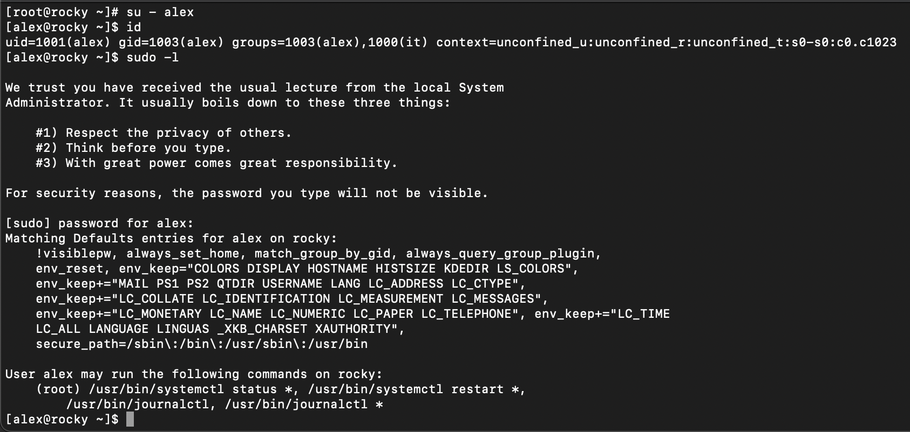
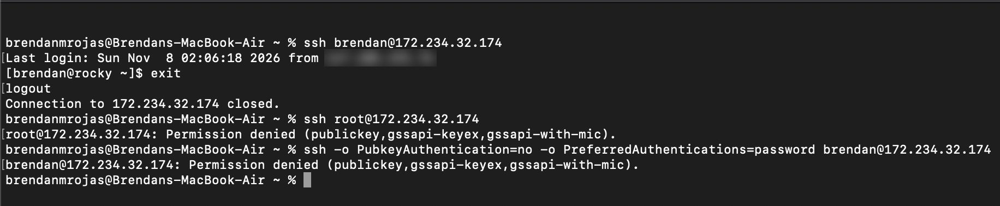
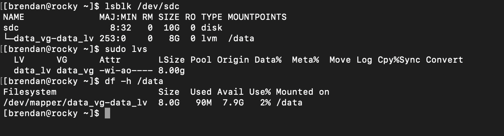
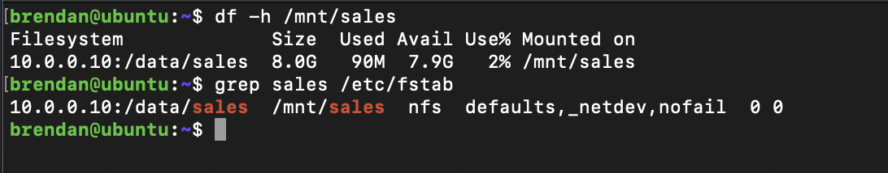
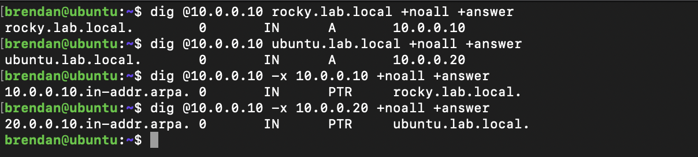
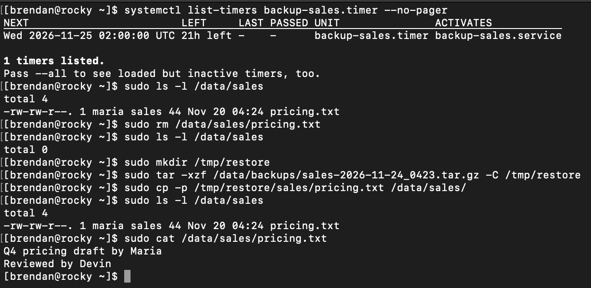
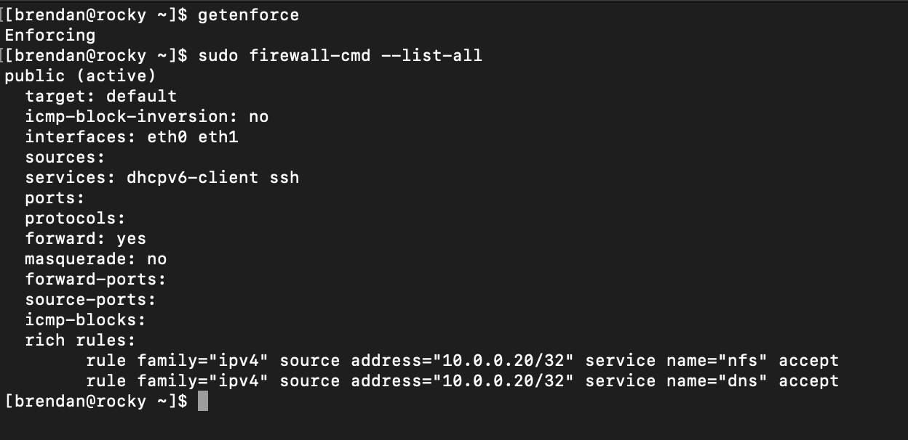
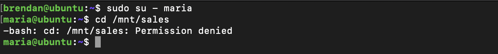
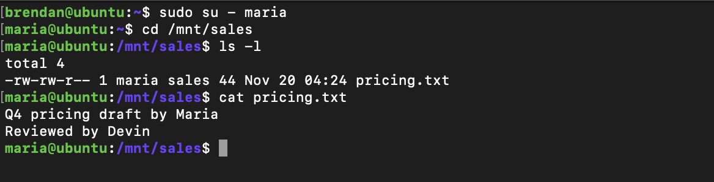
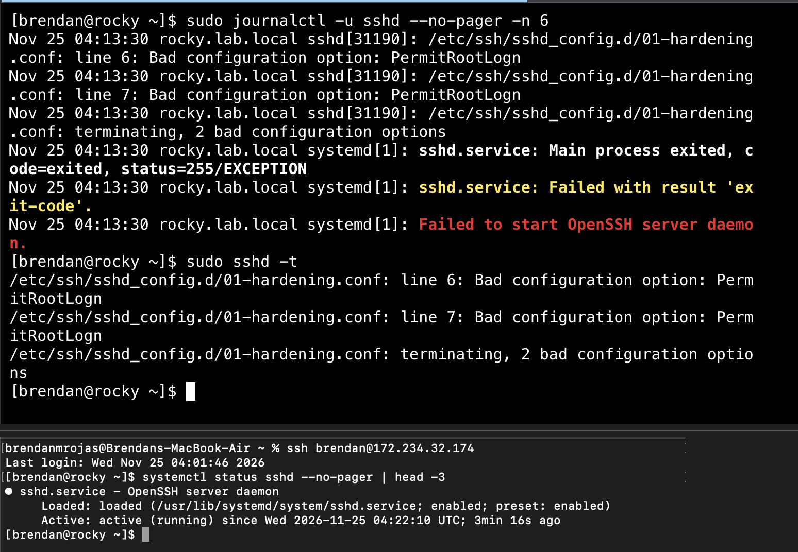

# Enterprise Linux Infrastructure

## What I Built

Two Linux servers set up like a small company's back office. A Rocky Linux 9 server acts as the file server and name server, and an Ubuntu 24.04 server acts as an employee's computer that depends on it. The lab has real user accounts with tiered admin rights, SSH locked to keys only, an LVM data disk that I grew live without downtime, a department shared drive over NFS, a DNS server with forward and reverse records, and nightly automated backups with a tested restore. SELinux stayed enforcing and the firewall stayed default deny the entire time. Then I broke the shared drive and SSH on purpose and fixed them like real help desk tickets.

Both servers ran on Linode (Akamai) cloud instances connected by a private VLAN, so company traffic never touched the public internet.

## Tools Used

* Rocky Linux 9 and Ubuntu 24.04 LTS on Linode (Akamai Cloud)
* Linode VLAN, Cloud Firewall, Block Storage, and LISH console
* Users, groups, and sudo (`useradd`, `usermod`, `visudo`)
* OpenSSH with ed25519 keys
* LVM (`pvcreate`, `vgcreate`, `lvcreate`, `lvextend`) and XFS
* NFS (`nfs-utils`, `nfs-common`, `/etc/exports`, `/etc/fstab`)
* dnsmasq and `dig` for DNS, systemd-resolved on Ubuntu
* Bash scripting, `tar`, systemd service and timer units
* SELinux (`getenforce`, `sestatus`, `restorecon`) and firewalld rich rules
* `journalctl`, `systemctl`, `sshd -t` for troubleshooting

## How It Works

```
                     My MacBook (Terminal)
                              |
                SSH with ed25519 key only
            (Linode Cloud Firewall allows my IP only)
                              |
          +-------------------+-------------------+
          |                                       |
   rocky.lab.local                         ubuntu.lab.local
   Rocky Linux 9                           Ubuntu 24.04
   eth1: 10.0.0.10                         eth1: 10.0.0.20
   * users, groups, limited sudo           * same UIDs and GIDs as Rocky
   * LVM disk at /data (8 GB)              * mounts the share at /mnt/sales
   * NFS share /data/sales  -------------> * asks Rocky for lab.local names
   * dnsmasq DNS            <------------- 
   * nightly backup timer
   * SELinux enforcing
   * firewalld: NFS and DNS
     allowed from 10.0.0.20 only
          |                                       |
          +------------ private VLAN -------------+
                      (lab-vlan, 10.0.0.0/24)
```

## Steps

1. Created an ed25519 SSH key on my Mac, added 2FA to the account that controls the cloud servers, and built a Cloud Firewall that drops everything except SSH from my own IP.
2. Built a Rocky Linux server and an Ubuntu server on a private VLAN. Patched and rebooted both.
3. Created `it` and `sales` groups and four users. Gave brendan full sudo through `wheel` and gave the `it` group a limited sudo rule that only allows checking and restarting services and reading logs.
4. Set up key login for my own admin account, then turned off root login and password login on both servers.
5. Attached a 10 GB block storage volume to Rocky, built LVM on it (PV, VG `data_vg`, LV `data_lv`), formatted it XFS, mounted it at `/data` through fstab, and grew it from 5 GB to 8 GB while it was mounted.
6. Created `/data/sales` owned by group `sales` with mode 2770 and setgid, so every new file belongs to the team.
7. Shared it over NFS to Ubuntu only, opened firewalld for NFS from Ubuntu only, matched user and group ID numbers on Ubuntu, and mounted the share at boot through fstab.
8. Tested as each user: Maria saved a file, Devin edited it, and an outsider was denied.
9. Ran dnsmasq on Rocky with forward and reverse records for both servers, allowed DNS from Ubuntu only, and pointed Ubuntu's resolver at Rocky for `lab.local`.
10. Wrote a Bash backup script with 7 day retention and logging, scheduled it nightly with a systemd timer, and tested a real restore.
11. Confirmed SELinux enforcing, fixed unlabeled contexts on the new disk, and removed an unused firewall service.
12. Broke the shared drive and SSH on purpose and fixed both (see Troubleshooting Tickets).

## Screenshots

### P1-01: Users, Groups, and Sudo Access

Alex is in the `it` group and `sudo -l` shows he can only check and restart services and read logs.

### P1-02: SSH Key-Only Login

Key login works for my admin account, while root login and a forced password login are both refused.

### P1-03: LVM Storage Expanded

The data volume grew from 5 GB to 8 GB while mounted at `/data`, with no downtime and no data lost.

### P1-04: NFS Shared Folder Mounted

Ubuntu has Rocky's Sales folder mounted over the private VLAN, and the fstab entry brings it back on every boot.

### P1-05: DNS Name Lookups Working

From Ubuntu, Rocky's DNS server answers forward (A) and reverse (PTR) lookups for both lab machines.

### P1-06: Automatic Backup and Restore

The nightly backup timer is scheduled, and a deleted file is restored from backup with its owner, group, and contents intact.

### P1-07: SELinux and Firewall Enabled

SELinux is enforcing, and firewalld only allows SSH plus NFS and DNS from Ubuntu's address.

### P1-08: Ticket: Shared Folder Access Denied (Broken)

Reproducing the ticket as Maria: the Sales share returns "Permission denied."

### P1-09: Ticket: Shared Folder Fixed

After the fix, Maria opens the share and reads her file again.

### P1-10: Ticket: SSH Failure Found in Logs

Top: from the LISH console, journalctl and `sshd -t` show the bad setting stopping SSH. Bottom: SSH working again from my Mac.

## Troubleshooting Tickets

### T1: "A user can't open the shared folder"

* **What broke:** Maria and Devin in Sales got "Permission denied" opening the Sales share on Ubuntu.
* **How I found it:** I reproduced it by switching to Maria's account. I ruled out the firewall first, because the error was an instant "Permission denied" instead of a timeout, which meant Rocky was answering. Permissions are the most common cause, so I checked them next with `ls -ld`.
* **Root cause:** The `/data/sales` folder's group had been changed from `sales` to `root`, so Sales users fell into "others," which has no access.
* **How I fixed it:** On Rocky, where the files actually live, I ran `chown root:sales /data/sales`. Fixing it from Ubuntu wasn't possible because `root_squash` strips root's power over the share.
* **How I verified it:** Switched to Maria on Ubuntu, opened the share, listed it, and read her file.

### T2: "SSH stopped working after a config change"

* **What broke:** After someone edited the SSH settings and restarted SSH, nobody could log into Rocky.
* **How I found it:** I logged in through the Linode LISH console, which doesn't depend on SSH. `systemctl status sshd` and `journalctl -u sshd` showed SSH failing to start, and `sshd -t` pointed straight to `01-hardening.conf`, lines 6 and 7.
* **Root cause:** A misspelled setting, `PermitRootLogn`, was added to the SSH config, and SSH was restarted without testing the file. SSH refuses to start with an unknown setting.
* **How I fixed it:** Removed the two bad lines, ran `sshd -t` until it came back clean, then restarted SSH.
* **How I verified it:** SSH'd in from my Mac with my key and confirmed `active (running)`.

### Problems I hit while building (not planned)

* **"Network is unreachable" on a brand new server.** The VLAN had been placed on eth0 and there was no public interface at all. A ping reply from the provider's own router pointed me there. Fixed the interface order and rebooted.
* **SSH timing out from home.** My firewall rule had never actually been saved. Re-added it and verified it after a page refresh.
* **Firewall blocking NFS on the private network.** The cloud firewall doesn't filter VLAN traffic, but Rocky's own firewalld did. Added a rich rule allowing NFS only from Ubuntu's address.
* **Backup script failed with "tar: command not found."** The minimal server image didn't include tar. Because the script uses `set -euo pipefail`, it stopped immediately instead of logging a false success. Installed tar and reran.
* **Unlabeled SELinux contexts on the new disk.** The fresh filesystem came up as `unlabeled_t`. Relabeled it with `restorecon -Rv /data` instead of turning SELinux off.
* **Smaller mistakes I caught and fixed:** users added to the wrong group, a username created with a capital letter, a sudo rule file with the wrong permissions, and a number typed into `chown` instead of `chmod`.

## What I Learned

* NFS identifies people by ID numbers, not names, so user and group IDs have to match on both servers or permissions break in confusing ways.
* The error message narrows the search: a timeout points to a firewall, an instant "Permission denied" means the server answered and said no, and "Connection refused" means nothing is listening.
* Always test a config before applying it (`sshd -t`, `visudo -c`, `findmnt --verify`, `dnsmasq --test`). Skipping that one step is exactly what caused Ticket T2.
* Least privilege works in layers: a cloud firewall at the edge, a host firewall that only lets specific machines use specific services, SELinux boxing in each program, and sudo rules that give people only what their job needs.
* What I'd improve next: keep backups off the server too (the 3-2-1 rule), and replace hand-matched local accounts with central accounts through Active Directory, which is my next project.
